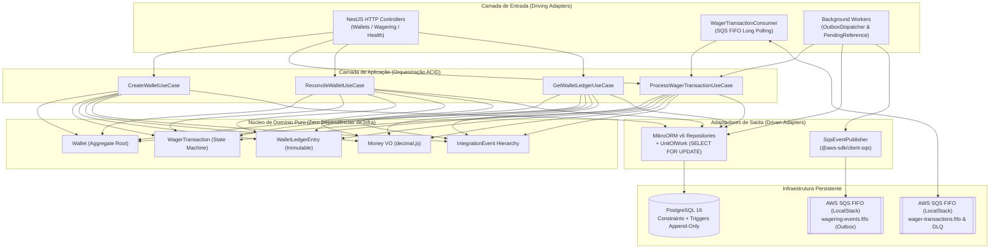

# Arquitetura e Decisões de Engenharia — Distributed Wagering Processor

Este documento detalha as decisões arquiteturais, os mecanismos de controle de concorrência, a estratégia de idempotência, o desenho de mensageria transacional (*Inbox/Outbox*), os *trade-offs* assumidos e os resultados do experimento de carga do **Distributed Wagering Processor**.

---

## 1. Visão Geral e Estilo Arquitetural

O sistema foi projetado utilizando **Clean Architecture / Hexagonal Architecture (Ports & Adapters)** combinada com **Domain-Driven Design (DDD) Tático**, isolando completamente o núcleo financeiro de detalhes de infraestrutura (HTTP, ORM, PostgreSQL e AWS SQS).



---

## 2. Escolha do ORM: Por que MikroORM v6?

A Seção 1 do desafio deixa a escolha do ORM em aberto mediante justificativa. Escolhemos o **MikroORM v6 (`@mikro-orm/postgresql`)** pelas seguintes razões técnicas:

1. **Unit of Work e Transações Explícitas (`em.transactional`)**: permite agrupar a mutação da `Wallet`, a gravação de `WagerTransaction`, a inserção de `WalletLedgerEntry`, o registro de `InboxMessage` e o enfileiramento de `OutboxMessage` em uma única transação ACID, garantindo que nenhum efeito colateral escape caso ocorra falha antes do `COMMIT`.
2. **Controle Fino de Locks Pessimistas (`LockMode.PESSIMISTIC_WRITE`)**: traduz nativamente a leitura da carteira em `SELECT ... FOR UPDATE`, bloqueando exclusivamente a linha da `walletId` alvo no PostgreSQL.
3. **Acesso Direto ao QueryBuilder/Knex para Operações Avançadas**: permite executar `SELECT ... FOR UPDATE SKIP LOCKED` no worker da Outbox (evitando contenção entre múltiplas instâncias) e realizar a agregação contábil `SUM(CASE WHEN direction = 'CREDIT' THEN amount ELSE -amount END)` diretamente no motor do banco durante a reconciliação.
4. **Separação entre Entidade de Domínio e Entidade de Persistência**: diferentemente do Active Record tradicional, mantivemos modelos de domínio puros (`src/domain/models/*`) com invariantes estritas e mapeadores explícitos (`toDomain()` / `fromDomain()`) nas entidades de banco (`src/infrastructure/database/entities/*`).
5. **Migrations Versionadas e Reversíveis (`up` / `down`)**: suporte completo a DDL customizado, incluindo constraints `CHECK (balance_amount >= 0)` e triggers PL/pgSQL (`prevent_ledger_modification()`) para garantir imutabilidade do ledger no nível do SGBD.

---

## 3. Precisão Monetária e Integridade Contábil

### 3.1 Value Object `Money` (`decimal.js`)
- **Proibição Absoluta de `number` / IEEE-754**: nenhum valor monetário trafega ou é calculado como `number`, `float` ou `double`.
- O Value Object [`Money`](file:///c:/Users/otako/OneDrive/%C3%81rea%20de%20Trabalho/Projetos/teste-jungleGaming/src/domain/models/money.ts) encapsula instâncias de `Decimal` (`decimal.js`) configuradas com precisão de 20 dígitos significativos e arredondamento bancário simétrico (`ROUND_HALF_EVEN`, escala fixa de 2 casas decimais).
- **Validação de Entrada**: `Money.from()` aceita exclusivamente strings decimais canônicas (`^\d+(\.\d{1,2})?$`), rejeitando números negativos, `NaN`, `Infinity`, notação científica (`1e5`) ou mais de 2 casas decimais sem arredondamento explícito.
- **No Banco de Dados**: todas as colunas financeiras utilizam `NUMERIC(18, 2)` e retornam como `string` no driver do PostgreSQL, preservando representação exata de ponta a ponta.

### 3.2 Ledger Imutável (*Append-Only*) e Invariante Universal
- Toda alteração de saldo (`OPENING`, `BET`, `WIN`, `REFUND`, `ROLLBACK`) exige obrigatoriamente um [`WalletLedgerEntry`](file:///c:/Users/otako/OneDrive/%C3%81rea%20de%20Trabalho/Projetos/teste-jungleGaming/src/domain/models/wallet-ledger-entry.ts) contendo `direction` (`CREDIT` ou `DEBIT`), `money`, `balanceBefore` e `balanceAfter`.
- O construtor de `WalletLedgerEntry` valida matematicamente a equação de conservação antes mesmo de persistir:
  - Para `CREDIT`: $\text{balanceBefore} + \text{money} == \text{balanceAfter}$
  - Para `DEBIT`: $\text{balanceBefore} - \text{money} == \text{balanceAfter}$
- Transações `LOSS` registram o desfecho da rodada na tabela `wager_transactions` e emitem `WagerTransactionProcessed`, mas **não** geram entrada no ledger nem emitem `WalletBalanceChanged`, pois não alteram o saldo.
- **Imutabilidade no PostgreSQL**: a migration [`Migration20261027000001_InitialSchema`](file:///c:/Users/otako/OneDrive/%C3%81rea%20de%20Trabalho/Projetos/teste-jungleGaming/src/infrastructure/database/migrations/Migration20261027000001_InitialSchema.ts) instala as triggers `trg_prevent_ledger_update` e `trg_prevent_ledger_delete` na tabela `wallet_ledger_entries`. Qualquer tentativa de `UPDATE` ou `DELETE` (mesmo via conexão administrativa) dispara exceção imediata no banco.

---

## 4. Estratégia de Concorrência e Isolamento por `walletId`

### 4.1 Pessimistic Write Lock (`SELECT ... FOR UPDATE`) vs Optimistic Locking
A unidade de concorrência do sistema é a **`walletId`**. No início da transação em [`ProcessWagerTransactionUseCase`](file:///c:/Users/otako/OneDrive/%C3%81rea%20de%20Trabalho/Projetos/teste-jungleGaming/src/application/use-cases/process-wager-transaction.use-case.ts), adquirimos um lock pessimista de escrita na linha da carteira:

```sql
SELECT * FROM wallets WHERE id = $1 FOR UPDATE;
```

**Por que escolhemos `SELECT ... FOR UPDATE` como mecanismo primário em vez de apenas Optimistic Locking (`version`)?**
- Em sistemas de apostas (*iGaming*), dois fenômenos ocorrem com frequência em uma mesma carteira (*hot wallet*):
  1. **Tempestade de Retries/Idempotência**: o provedor de jogos dispara dezenas de requisições idênticas simultaneamente por timeout de rede.
  2. **Apostas Concorrentes em Múltiplas Abas/Jogos**: duas apostas de `80.00 BRL` chegam no mesmo milissegundo para um saldo de `100.00 BRL`.
- Com **Optimistic Locking puro**, 50 requisições concorrentes leriam a mesma `version = 1`; 1 venceria o commit e 49 sofreriam `OptimisticLockError`, exigindo loops de retry na aplicação e multiplicando a carga sobre o PostgreSQL (*abort storm*).
- Com **`SELECT ... FOR UPDATE` adquirido antes da leitura de idempotência/inbox**, o próprio *row lock manager* do PostgreSQL enfileira as transações concorrentes **apenas para aquela `walletId`**:
  - A 1ª requisição processa o débito (`100.00 -> 20.00`), grava a transação, o ledger e a outbox, e faz commit.
  - As demais requisições da mesma aposta que estavam aguardando o lock leem imediatamente a transação já gravada e retornam `idempotentReplay: true` em $< 1\text{ ms}$, ou (no caso de uma segunda aposta distinta de `80.00 BRL`) leem o saldo atualizado de `20.00 BRL` e rejeitam determinísticamente com `INSUFFICIENT_FUNDS`.
  - **Zero Bloqueio Cruzado**: carteiras com `walletId` distintos possuem linhas distintas na tabela `wallets` e são processadas em **paralelo verdadeiro** sem qualquer contenção entre si.

### 4.2 Defesa em Profundidade no Schema SQL
Além das invariantes de domínio e do lock pessimista, o schema PostgreSQL impõe:
- `CONSTRAINT check_wallet_balance_non_negative CHECK (balance_amount >= 0)`: torna fisicamente impossível persistir saldo negativo no banco, mesmo diante de bugs de aplicação.
- `CONSTRAINT unique_player_currency UNIQUE (player_id, currency)`: impede criação concorrente de duas carteiras para o mesmo jogador e moeda.
- `CONSTRAINT unique_wager_idempotency_key UNIQUE (idempotency_key)` e `CONSTRAINT unique_provider_external_tx UNIQUE (provider_id, external_transaction_id)`: barreira final contra duplicidade de transações.

---

## 5. Idempotência e Hash Canônico (`payloadHash`)

A idempotência é 100% persistida no PostgreSQL (nunca em cache volátil em memória) e governada pelo header obrigatório `Idempotency-Key`.

### Algoritmo do `payloadHash` ([`canonical-hash.ts`](file:///c:/Users/otako/OneDrive/%C3%81rea%20de%20Trabalho/Projetos/teste-jungleGaming/src/domain/models/canonical-hash.ts))
1. Extraímos exclusivamente os campos de negócio da operação (`providerId`, `externalTransactionId`, `playerId`, `walletId`, `roundId`, `gameId`, `kind`, `money: { amount, currency }`, `referenceExternalTransactionId`). Metadados de transporte (headers HTTP, `correlationId`, `messageId` do SQS, timestamps de rede) **não** entram no cálculo.
2. O objeto passa por **canonicalização recursiva** (`canonicalizeJson`), ordenando lexicograficamente todas as chaves em todos os níveis e removendo propriedades `undefined`.
3. Calculamos o digest **SHA-256** (64 caracteres hexadecimais) sobre a string JSON canônica resultante.

| Situação | Comportamento | Status HTTP |
|---|---|---|
| Chave inédita | Processa normalmente e persiste `idempotency_key` + `payload_hash` | `200 OK` / `202 Accepted` / `422 Unprocessable Entity` |
| Mesma chave + mesmo `payloadHash` (estado terminal) | Retorna o resultado original sem reexecutar efeitos colaterais (`idempotentReplay: true`) | Mesmo status semântico da operação original |
| Mesma chave + `payloadHash` diferente | Rejeita imediatamente como tentativa de adulteração/colisão (`IdempotencyConflictError`) | `409 Conflict` |

---

## 6. Mapeamento Semântico de Status HTTP

Para que o provedor de jogos saiba exatamente quando deve **parar** (erro definitivo de negócio ou validação) e quando pode **retentar** (processamento pendente ou falha transitória), adotamos o seguinte contrato HTTP no [`WageringController`](file:///c:/Users/otako/OneDrive/%C3%81rea%20de%20Trabalho/Projetos/teste-jungleGaming/src/infrastructure/http/controllers/wagering.controller.ts) e no [`GlobalHttpExceptionFilter`](file:///c:/Users/otako/OneDrive/%C3%81rea%20de%20Trabalho/Projetos/teste-jungleGaming/src/infrastructure/http/filters/http-exception.filter.ts):

| Código HTTP | Significado no Domínio | Ação Recomendada ao Provedor |
|---|---|---|
| `200 OK` | Transação `PROCESSED` (incluindo replays idempotentes) | Sucesso definitivo (não reenviar) |
| `201 Created` | Carteira criada com sucesso (`POST /wallets`) | Sucesso definitivo |
| `202 Accepted` | Transação aceita em `PENDING_REFERENCE` (`REFUND`/`ROLLBACK` aguardando transação referenciada) | Aguardar resolução assíncrona ou consultar status depois |
| `400 Bad Request` | Payload malformado, `Idempotency-Key` ausente, `Money` inválido ou moeda incompatível (`CurrencyMismatchError`) | Erro de contrato do cliente (não reenviar sem corrigir) |
| `404 Not Found` | Carteira ou transação consultada não existe (`WalletNotFoundError`) | Verificar identificador |
| `409 Conflict` | Mesma `Idempotency-Key` com payload diferente (`IdempotencyConflictError`) ou carteira `(playerId, currency)` já existente (`WalletConflictError`) | Conflito de estado/identidade (não reenviar) |
| `422 Unprocessable Entity` | Rejeição por regra de negócio (`status: REJECTED`) com `failureCode` explícito (`INSUFFICIENT_FUNDS`, `NEGATIVE_BALANCE_PREVENTED`, `REFERENCE_ALREADY_REVERSED`, `INVALID_REFERENCE_KIND`) | Rejeição terminal de negócio (não reenviar) |
| `503 Service Unavailable` | Banco de dados ou SQS indisponíveis (`GET /health/ready`) | Falha transitória de infraestrutura (seguro retentar com backoff) |

---

## 7. Mensageria Assíncrona: SQS, Transactional Outbox, Inbox e Referências Fora de Ordem

### 7.1 Transactional Outbox (`OutboxDispatcherWorker` — Padrão *Claim-Publish-Confirm*)
- Eventos de integração ([`WalletBalanceChanged`](file:///c:/Users/otako/OneDrive/%C3%81rea%20de%20Trabalho/Projetos/teste-jungleGaming/src/domain/events/events.ts), [`WagerTransactionProcessed`](file:///c:/Users/otako/OneDrive/%C3%81rea%20de%20Trabalho/Projetos/teste-jungleGaming/src/domain/events/events.ts), [`WagerTransactionRejected`](file:///c:/Users/otako/OneDrive/%C3%81rea%20de%20Trabalho/Projetos/teste-jungleGaming/src/domain/events/events.ts), [`WagerTransactionPendingReference`](file:///c:/Users/otako/OneDrive/%C3%81rea%20de%20Trabalho/Projetos/teste-jungleGaming/src/domain/events/events.ts)) herdam da classe abstrata [`IntegrationEvent<T>`](file:///c:/Users/otako/OneDrive/%C3%81rea%20de%20Trabalho/Projetos/teste-jungleGaming/src/domain/events/integration-event.ts) e **nunca** são publicados no broker antes do commit do banco.
- Eles são serializados na tabela `outbox_messages` dentro da mesma transação SQL que altera o saldo e o ledger.
- Para evitar segurar conexões ou locks do PostgreSQL abertos durante chamadas de rede para o AWS SQS, o [`OutboxDispatcherWorker`](file:///c:/Users/otako/OneDrive/%C3%81rea%20de%20Trabalho/Projetos/teste-jungleGaming/src/infrastructure/messaging/outbox/outbox-dispatcher.worker.ts) implementa o protocolo **Claim-Publish-Confirm** em 3 fases:
  1. **Fase 1 — Claim (Transação SQL curta, `< 2 ms`)**: seleciona um lote pendente vinculado ao `TransactionContext` ativo via:
     ```sql
     SELECT * FROM outbox_messages
     WHERE published_at IS NULL AND (next_attempt_at IS NULL OR next_attempt_at <= NOW())
     ORDER BY occurred_at ASC
     LIMIT 50
      FOR UPDATE SKIP LOCKED;
      ```
      e aplica imediatamente um *short lease* (`claimLease`: `next_attempt_at = NOW() + 30s`, sem incrementar `attempts`), comitando a transação SQL antes de iniciar qualquer I/O de rede.
   2. **Fase 2 — Publish (Fora da transação SQL)**: publica cada evento de integração na fila dedicada **`wagering-events.fifo`** no AWS SQS FIFO via `@aws-sdk/client-sqs` (`MessageGroupId = aggregateId`, `MessageDeduplicationId = outbox.id`) sem manter nenhuma transação aberta no PostgreSQL e sem colidir com a fila de entrada de comandos (`wager-transactions.fifo`).
   3. **Fase 3 — Confirm (Transação SQL curta)**: grava `published_at = NOW()` em caso de sucesso ou chama `scheduleRetry(now)` (incrementando `attempts` e agendando *exponential backoff* $\min(2^{\text{attempts}} \times 500\text{ms}, 60\text{s})$) em caso de falha. Se o processo sofrer `SIGKILL` durante a Fase 2, o lease de 30s expira automaticamente e outra instância assume o envio.

### 7.2 Consumer SQS, Persistent Inbox, DLQ e Graceful Shutdown (`SIGTERM`)
- O [`WagerTransactionConsumer`](file:///c:/Users/otako/OneDrive/%C3%81rea%20de%20Trabalho/Projetos/teste-jungleGaming/src/infrastructure/messaging/sqs/wager-transaction.consumer.ts) consome a fila FIFO de comandos `wager-transactions.fifo` reutilizando exatamente o mesmo `ProcessWagerTransactionUseCase`.
- **Deduplicação via Inbox**: cada mensagem recebida é registrada na tabela `inbox_messages` (`PRIMARY KEY (consumer_name, message_id)`) dentro da mesma transação SQL da aposta, sob o lock pessimista da carteira.
- **ACK Estritamente Pós-Commit**: o comando `DeleteMessage` no SQS só é invocado **após** o commit da transação no PostgreSQL. Se o worker morrer entre o commit e o ACK, o SQS reentregará a mensagem após o *Visibility Timeout*; a segunda instância detectará o registro já processado em `inbox_messages` (e a `idempotency_key` em `wager_transactions`) e confirmará o ACK sem duplicar o débito/crédito.
- **Classificação de Falhas e DLQ**:
  - *Rejeição de negócio* (`INSUFFICIENT_FUNDS`, etc.): a transação é gravada como `REJECTED`, o evento `WagerTransactionRejected` vai para a Outbox e a mensagem recebe **ACK** (não é erro de fila).
  - *Erro permanente de contrato* (JSON corrompido, `InvalidMoneyError`, `IdempotencyConflictError`) ou *excesso de tentativas* (`ApproximateReceiveCount >= maxReceiveCount`): a mensagem é encaminhada para `wager-transactions-dlq.fifo` e removida da fila principal, incrementando a métrica `dlqMessagesCount`.
  - *Erro transitório* (queda momentânea de banco/rede antes do limite de tentativas): visibilidade ajustada com backoff para retry pelo SQS.
- **Graceful Shutdown (`SIGTERM`)**: ao receber `SIGTERM`, o consumer interrompe imediatamente novas leituras (`isShuttingDown = true`), aguarda as promessas *in-flight* até `shutdownTimeoutMs` e, caso alguma mensagem ainda esteja pendente após o timeout de drenagem, executa `ChangeMessageVisibilityCommand(..., VisibilityTimeout = 0)` para devolvê-la instantaneamente a outra instância ativa.

### 7.3 Resolução de Referências Fora de Ordem (`PendingReferenceWorker`)
- Como filas distribuídas ou integrações multi-canal podem entregar um `REFUND` ou `ROLLBACK` antes da `BET`/`WIN` original (Seção 7.1), adotamos a **Opção B (Armazenamento em `PENDING_REFERENCE` + Resolução Assíncrona)**:
  1. Quando a referência ainda não existe, a transação é salva com status `PENDING_REFERENCE` e emite `WagerTransactionPendingReference` (`HTTP 202 Accepted`).
  2. O [`PendingReferenceWorker`](file:///c:/Users/otako/OneDrive/%C3%81rea%20de%20Trabalho/Projetos/teste-jungleGaming/src/infrastructure/messaging/outbox/pending-reference.worker.ts) varre periodicamente as transações em `PENDING_REFERENCE`. Assim que a transação referenciada chega e atinge estado `PROCESSED`, o worker reexecuta o caso de uso aplicando a reversão no saldo e no ledger.
  3. Se a referência nunca chegar após `maxAttempts` (default: 5) ou `ttlMs` (default: 60s), o worker transiciona a transação para `REJECTED` com `failureCode = REFERENCE_TIMEOUT` e emite `WagerTransactionRejected`, evitando que transações órfãs fiquem pendentes indefinidamente.

### 7.4 Observabilidade de Conflitos de Lock e Divergências Contábeis (Seções 9 e 12)
- **Conflitos de Lock por Carteira (`lockConflictsCount`)**: sempre que duas ou mais transações concorrentes disputam simultaneamente o lock pessimista (`SELECT ... FOR UPDATE`) sobre o mesmo `walletId`, o observador injetado em `ProcessWagerTransactionUseCase` incrementa `lockConflictsCount` no [`MetricsService`](file:///c:/Users/otako/OneDrive/%C3%81rea%20de%20Trabalho/Projetos/teste-jungleGaming/src/infrastructure/metrics/metrics.service.ts). Operações paralelas em carteiras distintas não geram conflito.
- **Divergência na Reconciliação (`reconciliationDivergencesCount`)**: conforme exigido na Seção 9, o [`ReconcileWalletUseCase`](file:///c:/Users/otako/OneDrive/%C3%81rea%20de%20Trabalho/Projetos/teste-jungleGaming/src/application/use-cases/reconcile-wallet.use-case.ts) **jamais** sobrescreve silenciosamente o saldo caso detecte `storedBalance !== calculatedBalance`. Ele sinaliza `consistent: false` e `difference` na resposta HTTP, registra um erro estruturado (`logger.error`) com os saldos divergentes e incrementa `reconciliationDivergencesCount` em `/health/metrics`.

---

## 8. Autenticação e Identidade de Provedores (Seção 2)

Em conformidade com a Seção 2 do desafio (que define autenticação como opcional e fora do foco central de consistência/concorrência), não implementamos cadastro de usuários ou emissão artesanal de credenciais. Definimos a porta de extensão [`ProviderIdentityPort`](file:///c:/Users/otako/OneDrive/%C3%81rea%20de%20Trabalho/Projetos/teste-jungleGaming/src/infrastructure/http/guards/auth.guard.ts) consumida pelo [`AuthGuard`](file:///c:/Users/otako/OneDrive/%C3%81rea%20de%20Trabalho/Projetos/teste-jungleGaming/src/infrastructure/http/guards/auth.guard.ts), registrado globalmente via `APP_GUARD` no [`AppModule`](file:///c:/Users/otako/OneDrive/%C3%81rea%20de%20Trabalho/Projetos/teste-jungleGaming/src/app.module.ts):
- Os endpoints `/health/live`, `/health/ready` e `/health/metrics` são explicitamente abertos (`path.startsWith('/health')`).
- No MVP, o adaptador `NoopProviderIdentityPort` está registrado por padrão para facilitar os testes funcionais e de carga. Em produção, basta substituir o provider `ProviderIdentityPort` por um adaptador OIDC/JWKS (**Keycloak**, **Zitadel**, **AWS Cognito**) ou validação HMAC-SHA256 (`X-Provider-Signature`).

---

## 9. Experimento de Carga Real (`bun run test:load` — HTTP + PostgreSQL + SQS + `autocannon`)

Implementamos o benchmark automatizado em [`tests/load/load-test.ts`](file:///c:/Users/otako/OneDrive/%C3%81rea%20de%20Trabalho/Projetos/teste-jungleGaming/tests/load/load-test.ts) (executável via `bun run test:load`), que sobe a **aplicação NestJS real escutando via HTTP**, conectada a uma instância **real do PostgreSQL** (executando `SELECT ... FOR UPDATE`, `INSERT`, `UPDATE`, `COMMIT` com escrita em disco) e publica os eventos da Outbox via HTTP usando `@aws-sdk/client-sqs` (conectando automaticamente ao container LocalStack na porta `4566` quando ativo, ou ao servidor HTTP SQS local `LocalSqsHttpServer` caso o container não esteja rodando).

### 9.1 Ambiente do Experimento
- **SO / Arquitetura**: Windows 11 (`win32 10.0.26200 x64`)
- **CPU**: Intel(R) Core(TM) i7-10750H @ 2.60GHz (12 logical cores)
- **Memória RAM**: 15.9 GB
- **Runtime**: Bun `1.4.4` + NestJS `10.4` + MikroORM `6.3`
- **Banco de Dados**: PostgreSQL `18.6` (`x86_64-windows`, transações ACID reais com `SELECT ... FOR UPDATE`)

### 9.2 Metodologia e Resultados Reais Obtidos

| Métrica | Perfil A: Multi-Wallet HTTP Write (20 carteiras paralelas × 20 ops HTTP POST) | Perfil B: Hot Wallet + Idempotency Storm (1 carteira, 8 rajadas × 25 HTTP POSTs simultâneos) | Perfil C: `autocannon` HTTP Reconciliation (20 conexões simultâneas, 2s em `GET /wallets/:id/reconcile`) |
|---|---|---|---|
| **Requisições HTTP Totais** | `400` (`POST /wagering/transactions`) | `200` (`POST /wagering/transactions` na mesma carteira) | `3.140` (`GET /wallets/:id/reconcile`) |
| **Tempo Total** | `1.701,50 ms` | `696,87 ms` | `2.000,00 ms` |
| **Throughput Real** | **`235,09 req/s`** (transações ACID completas) | **`287,00 req/s`** (sob contenção de linha) | **`1.570,00 req/s`** (agregação SQL `SUM` no ledger) |
| **Latência p50** | `74,05 ms` | `40,88 ms` | `11,00 ms` |
| **Latência p95 / p97.5** | `186,58 ms` (p95) | `90,64 ms` (p95) | `19,00 ms` (p97.5) |
| **Latência p99** | `293,13 ms` | `114,04 ms` | `19,00 ms` |
| **Desfecho de Negócio** | `400 PROCESSED` (`200 OK`) | `50 PROCESSED`, `38 REJECTED` (`422`), `112 IDEMPOTENT_REPLAY` | `3.140` reconciliações `consistent: true` |
| **Taxa de Erro (5xx)** | **`0,00%`** | **`0,00%`** | **`0,00%`** |
| **Invariante Final (`balance == ledger`)** | **100% consistente** (`20/20` carteiras) | **100% consistente** (`1/1` hot wallet) | **100% consistente** (`discrepancy = 0.00`) |

- **Drenagem da Outbox para SQS**: `861` eventos de integração lidos do PostgreSQL (`FOR UPDATE SKIP LOCKED`) e publicados via HTTP `@aws-sdk/client-sqs` com `0` falhas.
- **Reconciliação Pós-Carga**: `21/21` carteiras verificadas no PostgreSQL real com discrepância contábil `0.00 BRL`.

### 9.3 Análise Crítica dos Resultados e Trade-offs
1. **Custo Real de Durabilidade ACID no Perfil A (`235 req/s` em 20 carteiras paralelas)**: cada `POST /wagering/transactions` aprovado executa uma transação SQL completa no PostgreSQL com `SELECT ... FOR UPDATE` na carteira, `SELECT` de idempotência, `UPSERT` na carteira, `UPSERT` na transação, `INSERT` no ledger append-only (com trigger de imutabilidade), 2 `UPSERT`s de eventos na tabela `outbox_messages` e `COMMIT` (WAL flush em disco). O gargalo aqui não é CPU da aplicação, mas o `fsync` do WAL no disco local e o tamanho do pool de conexões (`max = 25`).
2. **Contenção de Linha e Tempestade de Idempotência no Perfil B (`287 req/s`, `p99 = 114 ms`)**: quando 25 requisições HTTP atingem **a mesma carteira** simultaneamente (incluindo 15 replays concorrentes com a mesma `Idempotency-Key`), o `SELECT ... FOR UPDATE` do PostgreSQL enfileira as transações na linha da carteira. Assim que a primeira transação comita, as 14 duplicatas subsequentes leem o estado terminal já comitado e retornam `idempotentReplay: true` sem escrever no ledger nem na outbox (por isso o `p50` cai para `40,88 ms`), mantendo **zero erros 5xx** e **zero saldo negativo**.
3. **Leitura e Reconciliação (`1.570 req/s` via `autocannon`)**: consultas de leitura (`GET /wallets/:id/reconcile`) usam forks limpos sem lock pessimista, atingindo `p50 = 11 ms` e `p99 = 19 ms` com 20 conexões simultâneas.

---

## 10. Limitações Conhecidas e Evoluções para Produção

1. **Crescimento das Tabelas `wallet_ledger_entries`, `wager_transactions` e `outbox_messages`**:
   - *Limitação no MVP*: todas as entradas permanecem na tabela principal.
   - *Evolução*: particionamento declarativo do PostgreSQL (`PARTITION BY RANGE (created_at)`) mensal/semanal e job de expurgo/arquivamento de registros `outbox_messages` já publicados (`published_at < NOW() - INTERVAL '7 days'`) e `inbox_messages` antigos.
2. **Pool de Conexões sob Múltiplas Instâncias**:
   - *Limitação no MVP*: cada instância gerencia seu próprio pool direto no PostgreSQL (`DB_POOL_MAX=25`).
   - *Evolução*: introdução de **PgBouncer** em modo *transaction pooling* na frente do PostgreSQL e definição de `lock_timeout` (ex.: `3000ms`) e `statement_timeout` por sessão para evitar que uma transação lenta esgote conexões do pool.
3. **Observabilidade Distribuída**:
   - *Limitação no MVP*: métricas expostas via snapshot JSON em `/health/metrics` e logs estruturados via Pino.
   - *Evolução*: exportação nativa no formato Prometheus (`prom-client`) e instrumentação de *traces* distribuídos via **OpenTelemetry SDK** propagando `traceparent` nos atributos das mensagens SQS.

