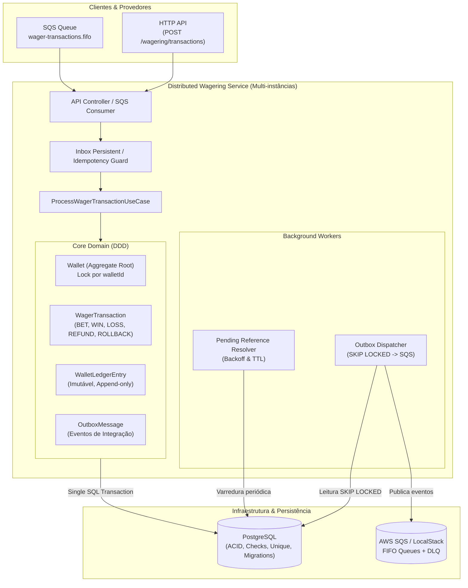
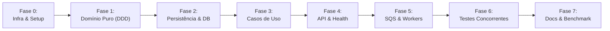

# Plano de Execução do MVP — Distributed Wagering Processor

> **Jungle Gaming Technical Challenge**  
> **Status:** Pronto para Execução  
> **Arquitetura:** Clean Architecture / DDD, Transactional Outbox, Persistent Inbox, Idempotência Estrita, Concorrência de Hot Wallet

---

## 1. Visão Geral e Critérios de Sucesso

O objetivo é desenvolver um serviço financeiro distribuído de alta consistência para processar transações de apostas (`BET`, `WIN`, `LOSS`, `REFUND`, `ROLLBACK`) sob garantia de entrega *at-least-once*, tolerante a duplicações, inversões de ordem e concorrência massiva entre múltiplas instâncias.

### Invariantes Invioláveis
1. **Precisão Monetária**: Nenhum uso de `number`/`float`. Valor monetário encapsulado no Value Object `Money` com precisão decimal fixa de 2 casas (`numeric(18,2)` no banco).
2. **Saldo Não Negativo**: Garantido tanto pelo Aggregate de Domínio quanto por constraint SQL (`CHECK (balance_amount >= 0)`).
3. **Ledger Auditável & Imutável**: Toda alteração de saldo gera exatamente 1 lançamento correspondente no ledger; $Saldo = \sum(Ledger)$.
4. **Idempotência Persistente**: Chave única `Idempotency-Key` no PostgreSQL com validação de payload canônico; rejeição de concorrência e sem memória volátil.
5. **Transactional Outbox & Inbox**: Persistência de estado da wallet, transação, ledger, inbox e outbox na **mesma transação SQL**. Eventos só são publicados após commit confirmado.
6. **Concorrência por Wallet**: Unidade de concorrência é a `walletId`. Nenhuma transação paralela pode gerar *lost update* ou saldo negativo.
7. **Multi-instância Real**: Suporte comprovado a $\ge 3$ instâncias ativas sem race conditions.

---

## 2. Arquitetura Alvo

---

## 3. Fases de Execução

---

### Fase 0: Preparação de Ambiente, Ferramental e Infraestrutura Base
**Objetivo**: Estabelecer runtime Bun, contêineres Docker, estrutura de diretórios e padrões de lint/build.

- [ ] **0.1 Setup do Host Local**
  - Instalar/Configurar `Bun 1.x` no ambiente de desenvolvimento.
  - Instalar/Configurar Docker & Docker Compose no ambiente.
- [x] **0.2 Inicialização do Projeto Bun + NestJS**
  - Criar `package.json`, `tsconfig.json` (strict: true), `bunfig.toml`.
  - Configurar dependências: `@nestjs/core`, `@nestjs/common`, `@mikro-orm/core`, `@mikro-orm/postgresql`, `@mikro-orm/migrations`, `@aws-sdk/client-sqs`, `decimal.js`, `pino`, `uuid`.
  - Configurar scripts no `package.json`:
    - `bun run start:dev`
    - `bun run build`
    - `bun test`
    - `bun run test:integration`
    - `bun run test:concurrency`
    - `bun run test:load`
    - `bun run migration:up` / `migration:create`
- [x] **0.3 Docker Compose & Serviços de Suporte**
  - Configurar `docker-compose.yml`:
    - PostgreSQL 16 com volume persistente e credenciais configuráveis.
    - LocalStack (com serviços `sqs` habilitados).
  - Script de inicialização do LocalStack para criar filas FIFO:
    - `wager-transactions.fifo` (com DLQ configurada)
    - `wager-transactions-dlq.fifo`
    - `wagering-events.fifo` (para publicação do outbox)
  - Configurar `.env.example` e `.env.test`.

---

### Fase 1: Núcleo de Domínio Puro (Zero Framework, TDD Estrito)
**Objetivo**: Implementar o modelo de domínio encapsulado conforme as seções 6 e 7 do README, garantindo 100% de cobertura com testes unitários puros.

- [x] **1.1 Value Object `Money`**
  - Representação interna com `Decimal` de precisão arbitrária, imutável.
  - Factory `Money.from({ amount: string, currency: string })` e `Money.zero(currency)`.
  - Rejeição estrita de entradas: `NaN`, `Infinity`, strings vazias, mais de 2 casas decimais, valores negativos em contratos.
  - Métodos aritméticos: `add`, `subtract`, `negate`, comparações (`isZero`, `isPositive`, `isNegative`, `isLessThan`, `equals`).
  - Serialização JSON com `amount` como string com 2 casas fixas e código ISO `currency`.
  - Proteção contra operações entre moedas diferentes (`CurrencyMismatchError`).
- [x] **1.2 Aggregate Root `Wallet`**
  - Construtor protegido e factories: `Wallet.open()` e `Wallet.rehydrate()`.
  - Métodos `debit(money)` e `credit(money)`.
  - Invariante de saldo nunca negativo (`InsufficientBalanceError`).
  - Invariante de moedas compatíveis.
  - Incremento de `version` estritamente quando há movimentação de saldo.
- [x] **1.3 Entidade `WagerTransaction`**
  - Enums: `WagerTransactionKind` (`OPENING`, `BET`, `WIN`, `LOSS`, `REFUND`, `ROLLBACK`) e `WagerTransactionStatus` (`PENDING`, `PENDING_REFERENCE`, `PROCESSED`, `REJECTED`, `FAILED`).
  - Validação de referências: `REFUND` exige referência a `BET`; `ROLLBACK` exige referência a `BET`, `WIN` ou `REFUND`.
  - Validação de igualdade de valor e mesma rodada/moeda na referência.
  - Cálculo de hash canônico do payload (`canonical JSON` determinístico com SHA-256).
  - Transições de estado com máquina de estados finitos; proteção de estados terminais (`PROCESSED`, `REJECTED`, `FAILED`).
  - Taxonomia de `FailureCode` padronizada e legível por máquina.
- [x] **1.4 Entidade Imutável `WalletLedgerEntry`**
  - Factory `create()` e `rehydrate()`.
  - Direção: `DEBIT` / `CREDIT`.
  - Invariante de balanceamento: `balanceBefore ± money === balanceAfter`.
  - Ausência total de métodos mutadores (imutabilidade estrutural).
- [x] **1.5 Mensageria de Domínio: `InboxMessage` e `OutboxMessage`**
  - `InboxMessage`: deduplicação por `(consumerName, messageId)` e registro de `processedAt`.
  - `OutboxMessage`: persistência de envelope de evento serializado, controle de tentativas e `nextAttemptAt` com backoff.
- [x] **1.6 Envelopes de Eventos de Integração (`IntegrationEvent<T>`)**
  - Classe abstrata `IntegrationEvent<T>` (com `eventId`, `aggregateId`, `correlationId`, `causationId`, `occurredAt`, `version`, `data`).
  - Eventos concretos tipados:
    - `WalletBalanceChanged`
    - `WagerTransactionProcessed`
    - `WagerTransactionRejected`
    - `WagerTransactionPendingReference`
- [x] **1.7 Testes Unitários de Domínio (Suite 100% Bun Test)**
  - Testes do `Money` (arredondamento, escala, validação de strings, moedas distintas).
  - Testes da `Wallet` (saldo inicial, créditos, débitos, recusa de saldo negativo, versionamento).
  - Testes de regras de negócio (`BET`, `WIN`, `LOSS`, `REFUND`, `ROLLBACK`, referências duplicadas ou inválidas).
  - Testes de transição de estado da `WagerTransaction`.

---

### Fase 2: Persistência Relacional, Migrations & Concorrência no Banco
**Objetivo**: Modelar o banco PostgreSQL com constraints rígidas a nível de schema e mapeamento no MikroORM.

- [x] **2.1 Schema SQL e Migrations Versionadas Reversíveis**
  - Tabela `wallets`:
    - `id` (UUID PK), `player_id`, `currency`, `balance_amount` (`NUMERIC(18,2)`), `version`, `created_at`, `updated_at`.
    - **Constraint:** `CHECK (balance_amount >= 0)`
    - **Constraint:** `UNIQUE (player_id, currency)`
  - Tabela `wager_transactions`:
    - `id`, `provider_id`, `external_transaction_id`, `idempotency_key`, `payload_hash`, `wallet_id` (FK), `player_id`, `round_id`, `game_id`, `kind`, `amount`, `currency`, `status`, `reference_external_transaction_id`, `reference_transaction_id` (FK), `failure_code`, `processed_at`, `created_at`.
    - **Constraint:** `UNIQUE (idempotency_key)`
    - **Constraint:** `UNIQUE (provider_id, external_transaction_id)`
  - Tabela `wallet_ledger_entries`:
    - `id`, `wallet_id` (FK), `transaction_id` (FK), `direction`, `amount`, `currency`, `balance_before`, `balance_after`, `created_at`.
    - **Trigger/Rule:** Bloqueio de `UPDATE` e `DELETE` (tabela append-only).
  - Tabela `inbox_messages`:
    - `message_id`, `consumer_name`, `payload_hash`, `received_at`, `processed_at`.
    - **Constraint:** `PRIMARY KEY (consumer_name, message_id)`
  - Tabela `outbox_messages`:
    - `id`, `aggregate_id`, `event_type`, `payload` (JSONB), `attempts`, `next_attempt_at`, `published_at`, `occurred_at`.
- [x] **2.2 Configuração do MikroORM v6**
  - Entities do MikroORM mantendo encapsulamento de domínio (Type Converters para `Money`).
  - Estratégia de Transação: `em.transactional()` com Unit of Work e controle de locks.
  - Concorrência de linha: `LockMode.PESSIMISTIC_WRITE` (`FOR UPDATE`) sobre a `wallet`.

---

### Fase 3: Casos de Uso & Lógica Transacional Atômica
**Objetivo**: Orquestrar a execução com garantia ACID unificada entre Wallet, Transação, Ledger, Inbox e Outbox.

- [x] **3.1 `CreateWalletUseCase`**
  - Criação da wallet garantindo unicidade `(playerId, currency)`.
  - Se `initialBalance > 0`: gera transação interna `OPENING` e `CREDIT` no ledger na mesma transação SQL.
  - Enfileira evento `WalletBalanceChanged` na outbox.
- [x] **3.2 `ProcessWagerTransactionUseCase` (Coração do Sistema)**
  - Idempotência: verificação de `idempotencyKey` + `payloadHash`. Replay idêntico retorna resultado anterior (`idempotentReplay: true`). Payload divergente retorna conflito (409).
  - Lock de concorrência: `walletId` bloqueado via `FOR UPDATE`.
  - Referências: `REFUND` e `ROLLBACK` resolvem referência ou entram em `PENDING_REFERENCE`.
  - Movimentação financeira e atualização de saldo.
  - Geração sincronizada de `WalletLedgerEntry`.
  - Registro de `OutboxMessage` e `InboxMessage` dentro do mesmo commit.
- [x] **3.3 `ReconcileWalletUseCase`**
  - Agregação SQL do ledger e comparação com `wallet.balance`.
  - Retorno do relatório de auditoria e métricas de divergência.
- [x] **3.4 `GetWalletLedgerUseCase`**
  - Consulta paginada por cursor opaco e estável.

---

### Fase 4: API HTTP, Middleware & Observabilidade
**Objetivo**: Expor endpoints REST especificados, validações de DTO, tratamento padronizado de erros e telemetria.

- [x] **4.1 Endpoints HTTP**
  - `POST /wallets`
  - `GET /wallets/:walletId`
  - `GET /wallets/:walletId/ledger?cursor=...&limit=50`
  - `GET /wagering/transactions/:transactionId`
  - `GET /providers/:providerId/wagering/transactions/:externalTransactionId`
  - `POST /wagering/transactions` (com header `Idempotency-Key` obrigatório)
  - `POST /wallets/:walletId/reconciliation`
  - `GET /health/live` e `GET /health/ready`
- [x] **4.2 Mapeamento Semântico de Erros HTTP**
  - 400 Bad Request / 404 Not Found / 409 Conflict / 422 Unprocessable Entity (`failureCode`) / 503 Service Unavailable.
- [x] **4.3 Observabilidade e Logs Estruturados**
  - Pino logger estruturado JSON (`correlationId`, `walletId`, `transactionId`, `providerId`). Sem dados sensíveis.
  - Métricas de transações, latência, concorrência e outbox lag.
- [x] **4.4 Estratégia de Autenticação (Alinhamento com Seção 2)**
  - Interface `ProviderIdentityPort` com `AuthGuard` desacoplado, documentando a integração com IdP no `ARCHITECTURE.md`.

---

### Fase 5: Mensageria Assíncrona, Workers & Resiliência
**Objetivo**: Implementar processamento em background com SQS, deduplicação em inbox, worker de outbox com locks de polling e resolução de referências pendentes.

- [x] **5.1 SQS Consumer (`WagerTransactionConsumer`)**
  - Fila FIFO `wager-transactions.fifo`.
  - Deduplicação via `InboxMessage`.
  - Execução do `ProcessWagerTransactionUseCase`.
  - ACK no SQS estritamente pós-commit.
  - Tratamento de erro transitório vs definitivo (DLQ: `wager-transactions-dlq.fifo`).
  - Suporte a `SIGTERM` (graceful shutdown).
- [x] **5.2 Outbox Worker (`OutboxDispatcherWorker`)**
  - Polling contínuo com `FOR UPDATE SKIP LOCKED`.
  - Publicação no SQS e marcação de `published_at` ou retry exponencial.
- [x] **5.3 Worker de Resolução de Referências Pendentes (`PendingReferenceWorker`)**
  - Reprocessamento de transações `PENDING_REFERENCE` via backoff.
  - Transição para `REJECTED` após esgotar tentativas/TTL com evento correspondente.

---

### Fase 6: Bateria de Testes Automatizados (Integração & Concorrência Real)
**Objetivo**: Validar exaustivamente todas as invariantes sob condições extremas de concorrência e falhas de infraestrutura.

- [x] **6.1 Testes de Integração com Banco e LocalStack Reais**
  - Execução de migrations e validação de constraints SQL.
  - Teste de atomicidade e integridade transacional.
  - Teste de deduplicação do Inbox sob redelivery do SQS.
- [x] **6.2 Suite de Concorrência Real (Seções 8 e 13)**
  - **Cenário 1**: 50 apostas idênticas em paralelo -> 1 débito único, 49 replays.
  - **Cenário 2**: Concorrência de saldo: Saldo `100.00 BRL`, duas apostas de `80.00 BRL` -> 1 aceita, 1 rejeitada, saldo final `20.00 BRL`.
  - **Cenário 3**: Wallets distintas processadas em paralelo sem bloqueio.
  - **Cenário 4**: $\ge 3$ instâncias concorrentes da aplicação.
  - **Cenário 5**: Worker crash recovery (morte após commit e antes de ACK).
  - **Cenário 6**: Dois publishers concorrentes sobre a mesma outbox.
  - **Cenário 7**: `ROLLBACK`/`REFUND` entregue antes da referência.
  - **Cenário 8**: Invariante universal final: $\text{wallet.balance} == \sum(\text{ledger})$.

---

### Fase 7: Documentação, Testes de Carga & Validação Final
**Objetivo**: Entregar documentação de nível sênior cobrindo decisões arquiteturais, comandos de inicialização e relatório de desempenho.

- [x] **7.1 Elaboração do `ARCHITECTURE.md`**
  - Justificativas do MikroORM, estratégia de concorrência (`FOR UPDATE` na wallet), transactional outbox, inbox e idempotência canônica.
- [x] **7.2 Atualização do `README.md`**
  - Guia de setup completo e comandos de execução dos testes.
- [x] **7.3 Implementação do Teste de Carga (`bun run test:load`)**
  - Script automatizado de benchmark com análise p50/p95/p99.
- [x] **7.4 Auditoria contra a Tabela de 100 Pontos**
  - Verificação de ausência de qualquer falha eliminatória.
